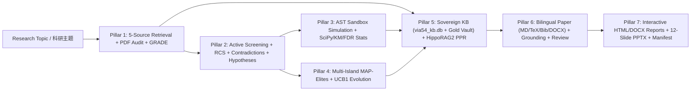

# via54SciForge · 深度技术调研与架构设计报告
# via54SciForge · Deep Research & Architecture Specification

---

## 1. 对 `via54Medit` 的深度解构与传承演化 · Deep Dissection & Evolution from `via54Medit`

通过对 `F:\agent\ai\projects\via54Medit`（从 `v4.9.0` 追平至 `v5.4.52` `5a7b4e0`）与两份技术剖析/核查报告的系统审计，我们提炼出 **5 项决定性的工程经验** 与 **6 项必须补齐的能力缺口**：

### 1.1 继承与升华的核心资产 · Inherited & Elevated Assets

| `via54Medit` 原生资产 | 工程真值分析 / Findings | `via54SciForge` 中的演进升级 / Upgrade |
|---|---|---|
| **L0 Producer 分类器** (`l0_producer_classifier.go`) | 通过 32+ 黑白名单关键词识别 `ReportLab` 截屏包壳、`Chrome Skia` 网页打印与真实期刊 PDF，解决 71% L0 误判问题 | 在 `literature/pdf_audit.py` 全面重构，并结合文本密度、DOI/NCT 正则抽提与异步 Crossref L0 校验 |
| **双源不拼合架构** (`dual_source.go`) | 严禁将摘要与表格强行拼成 1 个假 PDF；以 `main + fallback` 分离式 `DualSourceManifest` 显式标注各自证据边界 | 升级至文献核验与 PPTX `ppt_dual_source_manifest.json` 双层，同时用 ClinicalTrials APIv2 补全原 `nct_fetcher` TODO |
| **语义数值等价与 5 步应证链** (`h_column_builder.py` / `pdf_understand.py`) | 解决 `14.4%` vs 表格裸数字 `14.4` 的匹配断层，强制可视化 5 步应证推理链 | 在 `literature/verifier.py` 实现 `numerical_equivalence_variants()` + PyMuPDF 精确 bbox 标黄截图导出 |
| **诚实架构声明与真出图探针** (`render_doctor.py` / `SKILL.md`) | 区分「设计文档」与「实际代码」，拒绝低保真通道伪装 | 在 `core/doctor.py`、`deliverables/render_bridge.py` 与 `docs/HONEST_STATUS.md` 强制执行 |
| **多源并发扇出与模型定义** (`router/` / `pkg/types/`) | PubMed + OpenAlex + Semantic Scholar 并发融合、DOI 归一化、`EvidencePackage` 结构 | 扩展为全异步 `httpx` 5 源（新增 arXiv + EuropePMC）+ PRISMA 统计 + 含冲突扣分的升级版 GRADE |

### 1.2 解决的核心缺口 · Gaps Resolved

1. **原 `medit index` / `medit query` / FTS5 / HTTP API 均为 Phase 2 占位或空壳** → `via54SciForge` 全部真落地：内置 WAL+FTS5 状态库、只读直连本地 7.3 GB `via54_kb.db` + `gold_vault_node_z.db`、完整 FastAPI + Web Workbench 与 13 工具 MCP 2.x 服务端。
2. **缺乏研究合成、实验模拟与算法进化闭环** → 新增 Pillar 2（主动学习筛选/RCS/冲突矩阵/假说挖掘）、Pillar 3（AST 沙箱科学模拟 + SciPy 统计检验）、Pillar 4（MAP-Elites 多岛进化）。
3. **缺乏全格式论文撰写与自动化审稿** → 新增 Pillar 6（中英双语 `.md`/`.tex`/`.bib`/`.docx` + De-AI 文体审计 + 零幻觉引文校验 + 6 维同行评审）。

---

## 2. GitHub / Reddit / HuggingFace 同类开源项目横向对比 · Open-Source Landscape Benchmark

| 类别 / Category | 代表项目 / Projects | 核心范式与优势 / Strengths | 局限 / Gaps | `via54SciForge` 融合方案 |
|---|---|---|---|---|
| **文献 QA 与综述** Literature & Synthesis | `Future-House/paper-qa` (PaperQA2) `ASReview` (`r/MachineLearning`) `AutoSurvey` / `OpenScholar` | RCS 重排摘要在 LitQA2 超越人类专家；ASReview 主动学习高召回筛选；本地 Ollama 零幻觉思路 | 各自孤立，缺乏与仿真实验及本地主权图谱的联动 | 融合 TF-IDF 主动优先级排序、RCS 证据句抽取与跨文献矛盾矩阵 |
| **自主科研与实验** Autonomous Science | `SakanaAI/AI-Scientist-v2` `HKUDS/AI-Researcher` `Agent Laboratory` Stanford `Biomni` / `Robin` | v2 摆脱模板约束引入树搜索与 VLM 反馈；Biomni 聚合 150+ 工具；Agent Lab 协作分工 | 多偏重单次 ML 代码生成，缺少生物统计生存分析/ODE 与多源引文刚性应证 | AST 安全沙箱 + 4 大科研实验模板（RCT KM、ODE、ML 消融、网络扩散 ABM）+ FDR 多重校验 |
| **算法进化** Algorithm Evolution | `google-deepmind/alphaevolve` `algorithmicsuperintelligence/openevolve` `SakanaAI/ShinkaEvolve` | MAP-Elites + 岛屿模型 + LLM Diff 变更；ShinkaEvolve 提出新颖性拒绝采样与 Bandit 模型路由 | 单独用于算法优化，不产出文献综述或关联报告 | 内置 SQLite MAP-Elites 多岛存档、UCB1 算子老虎机、Jaccard 新颖性过滤与 AST+LLM 双模变异 |
| **知识图谱检索** GraphRAG & Memory | `HKUDS/LightRAG` `OSU-NLP-Group/HippoRAG` (v2) `microsoft/graphrag` | LightRAG 双层图+社区低成本增量更新；HippoRAG 2 仿海马体 PPR 多跳关联检索 | 通用库无法直接挂载用户私有的 `triples` 与 `gold_edges_raft` | `LocalKBFederation` 只读联邦接入 `via54_kb.db` + `gold_vault_node_z.db`，并运行 PPR + 模块度社区发现 |
| **论文转报告/PPT** Slides & Reporting | `HKUDS/Paper2Slides` `icip-cas/PPTAgent` | RAG 溯源映射防漂移；基于版式功能的迭代编辑与评估 | 缺少对学术论文引文合规与双源 PDF 截屏的刚性核验 | 输出 MD/HTML/DOCX 三格式衍生报告与 4 主题 12 页双语 PPTX + `ppt_dual_source_manifest.json` |

---

## 3. 七柱闭环数据流拓扑 · 7-Pillar Data Flow Architecture

---

## 4. 本地主权知识库全能力对接规范 · Sovereign KB Integration Spec

1. **只读保护铁律**：查询 `C:\KnowledgeBase_FastRuntime\VectorDB\via54_kb.db`（7.3 GB：`concepts`、`kb_fts`、`triples`、`kb_cross_references`、`concept_links`）与 `Z:\KnowledgeBase_HotCache\gold_vault_node_z.db`（`gold_edges_raft`）全程强制 `uri=True` + `?mode=ro`，绝不触发写锁或全表扫描 `all_classical_literature`。
2. **三路入库决策（Dry-Run 默认）**：`KBSyncManager` 复刻 `kb_ingest_pipeline.py` 的 `create / append / skip` 判定逻辑，默认仅预览，显式传入 `--apply` 时向 `D:\KnowledgeBase\03_Projects\via54SciForge\` 写入双语专著。
3. **HotCache 5MB 红线**：向 `Z:\KnowledgeBase_HotCache` 仅写入轻量化索引 JSON，物理拒绝任何超过 5MB 或 `.pptx`/`.pdf`/视频文件。
